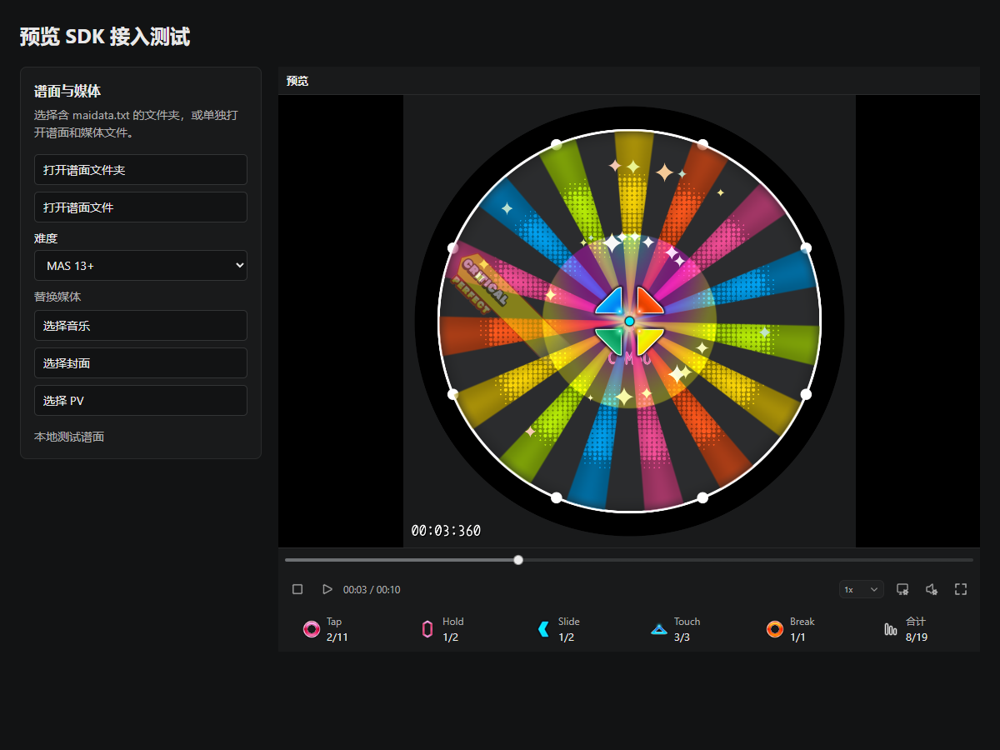

# MiaView Web 预览 SDK

## 预览测试站

测试页左侧选择谱面文件夹、谱面文件、音乐、封面和 PV，右侧通过 `createPreview()` 挂载播放器。测试页使用 `panelLayout: "fill"`，预览面板填满右侧容器。浏览器读取本地文件。



从已配置运行时的仓库生成独立静态测试站：

```sh
npm run build:sdk-preview-demo
cd build-devtools/sdk-preview-demo
python examples/sdk-preview/serve.py
```

服务启动后打开 [本地测试页](http://localhost:3031/examples/sdk-preview/index.html)。也可将整个输出目录复制到静态站点，访问 `examples/sdk-preview/index.html`。在源码目录使用 `npm run dev` 时，入口为 [3030 端口的测试页](http://localhost:3030/examples/sdk-preview/index.html)。

## 接入须知

从 [Web preview 构建列表](https://github.com/Team-MiaCode/MiaView_Web/actions/workflows/web.yml)选择 `standalone-preview` 对应提交的成功构建，下载 `miaview-preview-standalone`。取出同一版本的四个目录，放到宿主静态前缀下，例如 `public/miaview/`。

| 目录 | 内容 |
| --- | --- |
| `sdk/` | JavaScript 接入入口和 TypeScript 类型声明 |
| `renderer/` | iframe 页面、Qt JS/WASM、清单和音效 |
| `ui/` | 播放器界面、主题、字体和图标 |
| `services/` | 预览所需的共享资源服务 |

正式部署使用 HTTPS，本地使用 localhost。静态服务应为 `.mjs` 返回 JavaScript MIME 类型，为 `.wasm` 返回 `application/wasm`。浏览器需要 WebAssembly、WebGL 2 和 WebAudio，播放音频通常由用户点击触发。

宿主和播放器推荐同源部署。跨域接入时，模块服务器需允许宿主来源读取，播放器页面需允许宿主嵌入，媒体服务器需允许播放器来源读取。需要登录态的素材由宿主获取后传 Blob，或使用签名 URL。纯静态接入使用 `diagnostics: false`。重新挂载或卸载时调用 `destroy()`。

再分发时保留 `renderer/` 内的 `LICENSE`、`LICENSE_SCOPE.md` 和 `THIRD_PARTY_NOTICES.md`，并核对运行时和素材的适用许可。

### 开发与构建

已有匹配的 `miaview-preview` 产物时，将其中的完整 `renderer/` 合并到同提交的源码根目录，运行 `npm run check` 验证。需要从源码构建时，初始化 `vendor/MiaCode` 子模块，按 [工具链版本](native/toolchain.json)和 [CI 构建配置](.github/workflows/web.yml)配置 Qt 与 Emscripten，再运行 `npm run build:native` 和 `npm run check:source`。原生构建使用 `build-devtools/` 和 Release。运行 `npm run sync:products -- --runtime` 可从源码生成独立预览包。

## 调用属性

```html
<div id="chart-preview" style="width: 100%; height: 520px"></div>

<script type="module">
  import { createPreview } from "/miaview/sdk/index.mjs";

  const player = createPreview(document.getElementById("chart-preview"), {
    layout: "fit",
    panelLayout: "fill",
    resolution: { width: 1080, height: 1080 },
    diagnostics: false,
  });

  const stop = player.on("playing", ({ elapsedMs }) => {
    console.log("播放位置（毫秒）", elapsedMs);
  });

  try {
    await player.ready;
    await player.load({
      maidata: { url: "/charts/demo/maidata.txt" },
      audio: "/charts/demo/track.mp3",
      cover: "/charts/demo/bg.jpg",
      video: "/charts/demo/bg.mp4",
      difficulty: 5,
    });
  } catch (error) {
    console.error(error.message);
  }

  window.addEventListener("pagehide", event => {
    if (event.persisted) return;
    stop();
    player.destroy();
  });
</script>
```

| 创建属性 | 默认值 | 用法 |
| --- | --- | --- |
| `layout` | `"intrinsic"` | `"fit"` 让 iframe 填满宿主容器，宿主需提供高度。 |
| `panelLayout` | `"proportional"` | 完整面板默认按 741∶865 布局。`"fill"` 填满 iframe，配合 `layout: "fit"` 可分别指定容器宽和高。 |
| `resolution` | `1920×1080` | 初始画布尺寸，支持 16∶9 或 1∶1，单边为 1 至 4096 的整数。 |
| `controls` | `true` | 显示完整播放器。`false` 提供画面，宿主可用 SDK 组装控制区。 |
| `theme` | `"dark"` | 另有 `"light"`、`"legacy"`、`"legacy_light"`。 |
| `maxFps` | `60` | 不小于 30 的整数，或 `"unlimited"`。 |
| `preferencesKey` | 省略 | 指定渲染器来源下的本地存储键，用于保存面板设置。 |
| `diagnostics` | `true` | 控制诊断上报，纯静态部署设为 `false`。 |
| `rendererUrl` | SDK 相对路径 `../renderer/index.html` | 指定播放器 iframe 的地址。 |
| `allow` | `"autoplay; fullscreen"` | 指定 iframe 的权限策略。 |
| `sandbox` | `"allow-scripts allow-same-origin"` | 指定 iframe 的 sandbox 属性。 |
| `audioContextOwner` | `"renderer"` | 音频上下文归属。`"opener"` 用于同源的独立预览窗口。 |
| `pvTimeoutMs` | `30000` | PV 加载与首帧准备时限，单位毫秒，支持 `"unlimited"`。 |
| `timeoutMs` | `120000` | 初始化和命令时限，单位毫秒。 |

### 谱面、媒体与播放

| 接口 | 用法 |
| --- | --- |
| `ready` | 等待播放器初始化。 |
| `load({ maidata, audio, cover, video, difficulty })` | `maidata` 接受谱面正文、Blob 或 `{ url }`。媒体可省略，也可传 Blob、URL 字符串或 `{ url }`。`difficulty` 使用谱面已有编号，范围为 1 至 7。返回标题、当前难度、难度列表和时长。 |
| `selectDifficulty(id)` | 切换已加载谱面的难度。 |
| `play()`、`pause()`、`restart()`、`seek(second)` | 控制播放，跳转位置以秒为单位。 |
| `setResources({ audio, cover, video })` | 替换指定素材，传 `null` 移除对应素材。 |
| `setCanvasSize({ width, height })` | 运行中调整画布分辨率，宽高为 1 至 4096 的整数。面板布局由宿主 CSS 和 `panelLayout` 决定。 |
| `setSettings(options)`、`setMediaSettings({ hidePv })` | 更新画面设置或切换 PV 显示。 |
| `setPlayback({ rate })`、`getState()` | 设置播放倍率，或获取当前状态。 |
| `on(type, listener)` | 订阅 `progress`、`loaded`、`playing`、`paused`、`ended`、`error` 等事件，返回取消订阅函数。 |
| `destroy()` | 卸载播放器并释放实例资源。 |

完整类型见 [sdk/index.d.mts](sdk/index.d.mts)。另有[宿主接入说明](docs/PREVIEW_SDK_INTEGRATION_ZH.md)与 [React 示例](examples/react-preview.jsx)。
