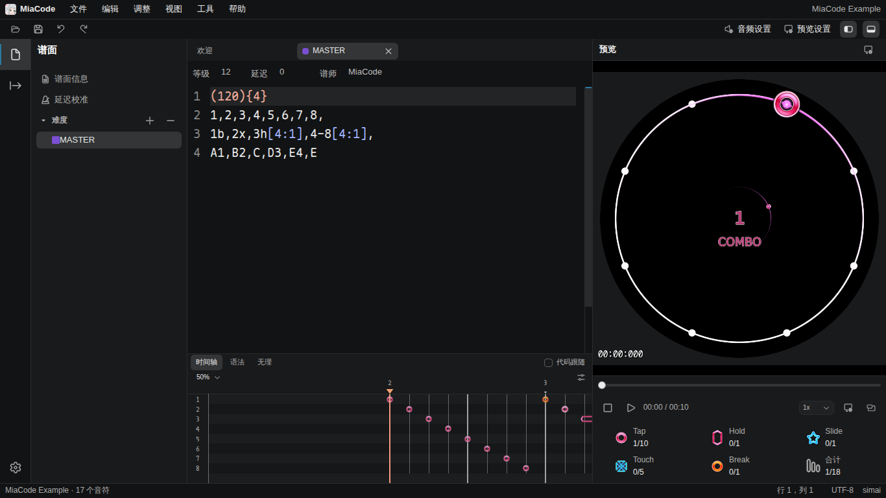

# MiaView Web 编辑器

MiaView Web 是面向 maimai 的 Simai 谱面编辑器。工作台包含谱面编辑、时间轴、实时预览、无理检测、封面制作和视频导出。本分支维护编辑器、独立预览与两套 SDK 的共享源码。谱面解析、分析和预览场景来自 [MiaCode](https://github.com/Team-MiaCode/MiaCode)，通过 Qt Quick 和 WebAssembly 在浏览器中运行。

## 在线使用

- [完整编辑器](https://team-miacode.github.io/MiaView_Web/feature/)
- [预览 SDK 接入测试](https://team-miacode.github.io/MiaView_Web/standalone-preview/examples/sdk-preview/index.html)



在工作台使用「打开」选择谱面文件夹，也可从欢迎页载入示例。工作台读取同目录的 `maidata.txt` 和匹配的媒体文件，例如 `track.mp3`、`bg.jpg`、`bg.mp4` 或 `pv.webm`。文件在浏览器中读取。选择包含多个谱面的目录时，可从列表中选取工程。

- **编辑谱面**：修改 Simai 正文、曲目信息和难度，使用语法补全、查找替换、书签、谱面变换与预览触区输入。
- **检查与试听**：从时间轴定位拍点，按区间播放，查看音符统计、语法诊断和无理检测结果。工作台支持分离预览及 BPM、延迟检测。
- **管理工程**：保存当前谱面或全部修改，导入音乐、封面和 PV，通过最近工程或本地恢复数据继续编辑。保存方式随浏览器文件权限而定，可写入目录或下载工程 ZIP。
- **制作与导出**：制作封面，设置导出范围与片头，输出预览视频或 WAV 音频。视频编码格式取决于浏览器支持的编解码器。

## 下载与部署

在 [Web preview 构建列表](https://github.com/Team-MiaCode/MiaView_Web/actions/workflows/web.yml?query=branch%3Afeature%2Fweb-editor-migration) 选择本分支对应提交的成功运行，在 **Artifacts** 中下载。构建产物保留 14 天。

| 产物 | 用途 |
| --- | --- |
| `miaview-pages` | 部署包含工作台、独立预览和 SDK 示例的完整静态站 |
| `miaview-editor` | 独立运行或嵌入编辑器，包含编辑器 SDK 和预览 SDK |
| `miaview-preview-standalone` | 独立运行或嵌入播放器，包含预览 SDK |
| `miaview-preview` | 获取与源码提交对应的 `renderer/`，用于本地开发，也包含工作台和配套 SDK 目录 |

静态部署时保留解压后的目录结构。使用 HTTPS 或通过 localhost 调试，静态服务器为 `.mjs` 返回 JavaScript MIME 类型，为 `.wasm` 返回 `application/wasm`。浏览器需支持 WebAssembly、WebGL 2 和 WebAudio。GitHub Pages 的 [部署记录](https://team-miacode.github.io/MiaView_Web/deployment.json) 提供各入口对应的提交号。

## SDK 接入

- **编辑器**使用 `sdk/editor.mjs` 中的 `createEditor()`。将 `miaview-editor` 解压后的目录部署到静态前缀，例如下例的 `./miaview/`。编辑器 iframe 会加载目录根部的工作台代码。
- **预览播放器**使用 `sdk/index.mjs` 中的 `createPreview()`。从同一份 `miaview-preview-standalone` 部署 `sdk/`、`renderer/`、`ui/` 和 `services/`。

TypeScript 类型声明与入口文件同名。纯静态部署使用 `diagnostics: false`。跨域接入时，静态服务器需允许宿主加载模块，渲染器页面需允许宿主嵌入，媒体服务器需允许渲染器来源读取资源。

```html
<div id="editor" style="height: 80vh"></div>
<script type="module">
  import { createEditor } from "./miaview/sdk/editor.mjs";

  const editor = createEditor(document.querySelector("#editor"), { diagnostics: false });
  await editor.ready;
  await editor.load({ maidata: "&title=Demo\n&lv_5=12\n&inote_5=(120){4}1,2,3,4,E" });

  window.addEventListener("pagehide", event => {
    if (event.persisted) return;
    editor.destroy();
  });
</script>
```

- 编辑器读写接口见 [编辑器 SDK 类型](sdk/editor.d.mts) 与 [工作台命令](docs/WEB_EDITOR_COMMANDS_ZH.md)。完整接入示例见 [examples/editor-demo.mjs](examples/editor-demo.mjs)。
- 预览加载、控制与事件见 [预览 SDK 接入指南](https://github.com/Team-MiaCode/MiaView_Web/blob/standalone-preview/docs/PREVIEW_SDK_INTEGRATION_ZH.md) 与 [预览 SDK 类型](sdk/index.d.mts)。独立 SDK 发布和接入测试页由 [standalone-preview 分支](https://github.com/Team-MiaCode/MiaView_Web/tree/standalone-preview) 维护。

## 本地开发

使用 Git 和 Node.js 22+ 检出编辑器分支及固定的 MiaCode 子模块。

```sh
git clone --branch feature/web-editor-migration --recurse-submodules https://github.com/Team-MiaCode/MiaView_Web.git
cd MiaView_Web
npm run runtime:fetch -- https://team-miacode.github.io/MiaView_Web/feature/renderer/
npm run check:source
npm run dev
```

访问 [本地工作台](http://127.0.0.1:3030/) 或 [本地编辑器接入示例](http://127.0.0.1:3030/examples/editor.html)。`runtime:fetch` 校验上游提交、原生构建指纹和文件哈希。也可下载对应源码提交的 `miaview-preview`，将其中的 `renderer/` 复制到仓库根目录，执行 `check:source` 和 `dev`。修改原生桥接、MiaCode 子模块或工具链后，按下节构建运行时。

## 从源码构建

需要 Git、Node.js 22+、Python、CMake 3.24+ 和 Ninja。[工具链配置](native/toolchain.json) 固定 Qt WASM、主机 Qt 和 Emscripten 版本。原生构建使用 Release，工作目录为 `build-devtools/`，运行时输出到 `renderer/`。

在 Ubuntu 上安装 `python3-venv`、`libegl1`、`libopengl0`、`libxcb-cursor0` 和 `libxkbcommon-x11-0` 后，在仓库根目录执行：

```sh
python3 -m venv .deps/python
.deps/python/bin/python -m pip install -r scripts/qt-requirements.txt
.deps/python/bin/python scripts/install-qt.py
git clone --depth 1 https://github.com/emscripten-core/emsdk.git .deps/emsdk
.deps/emsdk/emsdk install 4.0.7
.deps/emsdk/emsdk activate 4.0.7
```

Windows 使用 PowerShell：

```powershell
python -m venv .deps/python
.\.deps\python\Scripts\python.exe -m pip install -r scripts/qt-requirements.txt
.\.deps\python\Scripts\python.exe scripts/install-qt.py
git clone --depth 1 https://github.com/emscripten-core/emsdk.git .deps/emsdk
.\.deps\emsdk\emsdk.bat install 4.0.7
.\.deps\emsdk\emsdk.bat activate 4.0.7
```

构建、校验和打包：

```sh
npm run build:native
npm run check:source
npm run build:pages
npm run sync:products -- --runtime
```

`build:pages` 输出 `build-devtools/pages/`，`sync:products` 输出 `build-devtools/products/editor/` 与 `build-devtools/products/preview/`。重复打包可用 `npm run build:pages -- build-devtools/site-v2` 或 `npm run sync:products -- --runtime --output=build-devtools/products-v2` 指定新目录。

源码检查使用 `npm run check:repo` 和 `npm test`。浏览器验收、类型检查和 GitHub Pages 部署流程见 [GitHub Actions 工作流](.github/workflows/web.yml)。

## 项目资料

- [独立编辑器说明](products/editor/README.md) · [独立预览说明](products/preview/README.md)
- [编辑器迁移计划](docs/WEB_EDITOR_MIGRATION_PLAN_ZH.md) · [界面验收](docs/WEB_EDITOR_UI_ACCEPTANCE_ZH.md)
- [MiaCode 许可](vendor/MiaCode/LICENSE) · [第三方依赖与素材许可](vendor/MiaCode/THIRD_PARTY_NOTICES.md)。运行时的许可文件随 `renderer/` 分发。
