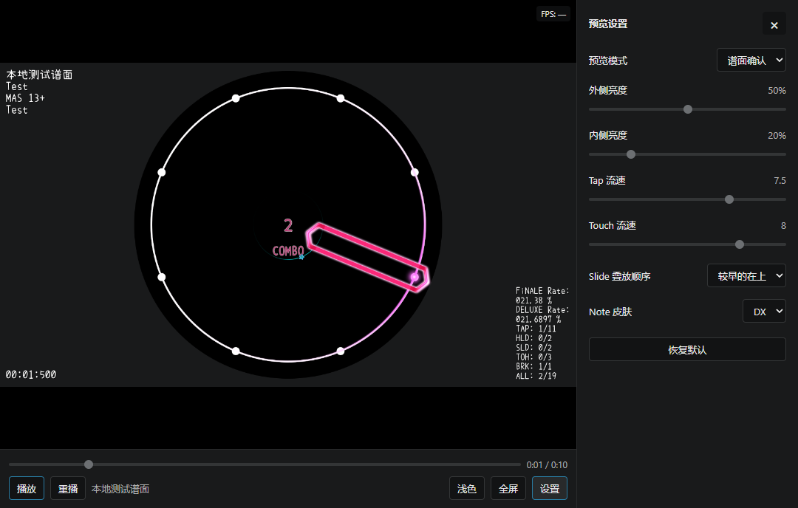
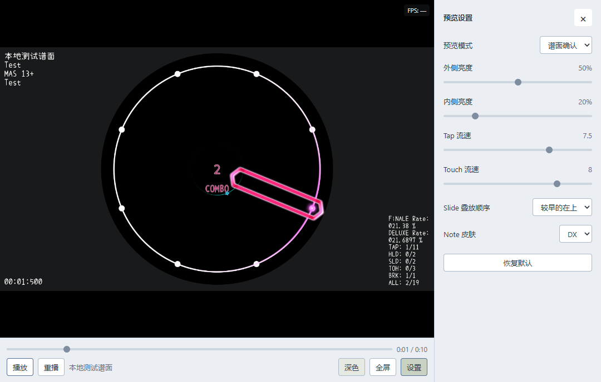
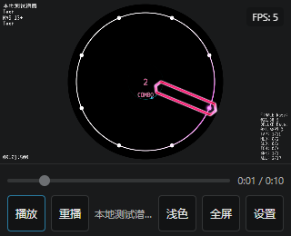

# MiaView_Web

| 网页入口 | 对应分支 | 测试内容 |
| --- | --- | --- |
| **[Feature 编辑器测试版](https://team-miacode.github.io/MiaView_Web/feature/)** | `feature/web-editor-migration` | 网页编辑器与阶段功能 |
| [Main 发布版](https://team-miacode.github.io/MiaView_Web/) | `main` | 已发布的谱面预览 |

Feature 测试版通过“打开”选择谱面文件夹，载入其中的 `maidata.txt`、`track.*`、`bg.*` 和 PV。文件在浏览器中读取。各入口随对应分支的阶段提交更新。

MiaView_Web 提供 maimai 谱面编辑工作台与实时预览 SDK，支持 Simai 格式。它基于 [MiaCode](https://github.com/Team-MiaCode/MiaCode) 的原生解析器和预览场景，通过 WebAssembly、Qt Quick 和 WebGL 2 绘制画面，通过 WebAudio 播放音乐与判定音效。工作台采用 HTML/CSS 与原生 ES modules，入口为 `index.html`。

本项目通过 `vendor/MiaCode` 子模块跟进 MiaCode `dev`，并固定确切提交。解析、分析和预览场景复用上游代码；浏览器宿主、音视频接入、JavaScript SDK 和网页界面由本仓维护。更新上游需要显式更新子模块并重建播放器。

编辑器的阶段要求与验收记录见[迁移计划](docs/WEB_EDITOR_MIGRATION_PLAN_ZH.md)和[UI 验收计划](docs/WEB_EDITOR_UI_ACCEPTANCE_ZH.md)。`editor/` 包含独立编辑器模板的入口、界面、SDK、运行时适配器、构建脚本与源版本配置。

## 功能一览

- 加载 `maidata.txt`，接受谱面原文、`File` / `Blob` 和网络 URL。
- 使用音乐、背景图片或 PV 视频搭配谱面播放。
- 播放、暂停、跳转、重播和切换难度。
- 调整音符流速、内外圈亮度，切换 SD / DX 皮肤与预览模式。
- 支持深色、浅色、经典深色与经典浅色主题，设置面板适配桌面和窄屏。
- 支持 16:9 和 1:1 画面，最大预览帧率可设为不小于 30 的整数或不限，默认 60 FPS。
- 提供 ES module SDK、TypeScript 类型声明和加载 / 播放诊断接口。

## 预览效果

桌面预览与设置面板：



浅色主题：



窄屏播放器：



## 获取播放器

Git 仓库和源码 ZIP 只包含源码，不包含运行所需的生成 JS / WASM。获取可直接使用的产品有以下方式：

| 方式 | 用途 | 是否需要本地编译 |
| --- | --- | --- |
| [Main 发布版](https://team-miacode.github.io/MiaView_Web/) | 查看自己的本地谱面 | 否 |
| [Feature 编辑器测试版](https://team-miacode.github.io/MiaView_Web/feature/) | 打开谱面文件夹并测试网页编辑器 | 否 |
| CI 产物 `miaview-preview` | 嵌入其他网站，或配合源码进行本地测试 | 否 |
| CI 产物 `miaview-pages` | 部署完整的静态预览网站 | 否 |
| [从源码构建](#开发与构建) | 修改播放器、更新上游或获取没有现成产物的版本 | 是 |

下载 CI 产物：

1. 打开 [Web preview Actions](https://github.com/Team-MiaCode/MiaView_Web/actions/workflows/web.yml)。
2. 选择目标分支和提交的成功运行，在运行详情的 **Artifacts** 中下载产物。
3. 解压并保留目录结构；与本地源码配合使用时，产物必须对应同一个 MiaView 提交。

| 产物 | 内容 | 使用入口 |
| --- | --- | --- |
| `miaview-preview` | `sdk/`、完整 `renderer/`、`backend/` 和 README | 见[本地运行](#本地运行)或[网站集成](#集成到你的网站) |
| `miaview-pages` | `index.html`、`examples/`、`sdk/` 和完整 `renderer/` | 见[部署预览网站](#部署预览网站) |

CI 产物保留 14 天。产物过期或没有对应运行时，可以在有权限的仓库中手动运行工作流，或自行构建。当前未发布 npm 包；接入时直接部署产物中的静态目录。

## 本地运行

使用预编译产物进行本地测试，只需要 Git 和 Node.js 22+，无需安装 Qt 或编译 C++。

先拉取源码：

```sh
git clone https://github.com/Team-MiaCode/MiaView_Web.git
cd MiaView_Web
```

从与源码相同提交的 `miaview-preview` 产物中，将完整 `renderer/` 复制到仓库根目录，覆盖已有目录中的对应文件。如果没有匹配产物，先按[构建说明](#开发与构建)生成播放器。然后运行：

```sh
npm run check
npm run dev
```

编辑器主入口为根目录的 `index.html`，通过 HTTP/HTTPS 加载。开发服务启动后，打开 <http://127.0.0.1:3030/index.html>。双击 HTML 时，页面显示本地服务启动命令和编辑器链接。

无需执行 `npm install`。“打开”与 `Ctrl+O` 选择整个谱面文件夹，网页保留该目录的文件清单。`maidata.txt` 与同目录的 `track.mp3/wav/flac/ogg/m4a`、`bg.jpg/png/jpeg/webp`、`bg.mp4` 或 `pv.mp4/webm` 按 v2 的资源命名关系载入，分别用于谱面、音乐、背景与 PV。集合目录包含多个谱面时，工作台显示谱面文件夹选择窗口。

示例页可切换分辨率和最大帧率。修改这些选项后会重新创建播放器、加载当前谱面并回到起点，默认暂停。

| 选项 | 可选值 | 默认值 |
| --- | --- | --- |
| 分辨率 | 1920×1080、1080×1080 | 1920×1080 |
| 最大帧率 | 30、60、90、120、144、165、240 FPS、不限 | 60 FPS |

开发服务器只监听本机地址。dev 示例会先将文件上传到本机临时服务，再通过公开 SDK 加载 HTTP URL，用于测试下载、缓存和诊断；正式静态网站的本地文件加载流程见下一节。

## 部署预览网站

下载 `miaview-pages` 后，将解压出的全部内容上传到静态服务器即可。服务器不需要 Node.js、谱面上传服务或日志后台。用户在页面中选择本地谱面和媒体，文件只在浏览器中读取。

如果已经在源码仓库中获取或构建了完整播放器，也可以自行打包：

```sh
npm run check
npm run build:pages
```

输出目录为：

```text
artifacts/pages/
├── index.html
├── examples/
├── sdk/
├── renderer/
└── .nojekyll
```

部署该目录内的全部内容，保留相对目录结构及生成的 `.nojekyll`。网站可以放在域名根目录，也可以放在项目子路径。打包要求输出目录不存在；重复打包可换一个目录：

```sh
npm run build:pages -- artifacts/site-v2
```

本地验证静态输出可以使用 Python：

```sh
python3 -m http.server 8080 --bind 127.0.0.1 --directory artifacts/pages
```

Windows 使用 `python` 代替 `python3`。打开 <http://localhost:8080>，不要直接双击 HTML 使用 `file://` 访问。

页面加载谱面后，还可以单独选择其他目录的本地音乐或 PV，或移除 PV 恢复静态背景。替换素材会回到起点并暂停。PV 只提供视频背景，声音来自单独的音乐文件和判定音效。

## 集成到你的网站

### 放置静态资源

从 `miaview-preview` 或本地构建结果中，将完整 `sdk/` 与 `renderer/` 一起复制到网站静态目录，例如：

```text
public/
└── miaview/
    ├── sdk/
    └── renderer/
```

部署后应能访问 `/miaview/sdk/index.mjs` 和 `/miaview/renderer/index.html`。保留播放器内的 JS、WASM、音效、主题、构建清单和许可文件。纯静态接入不需要 `backend/`，创建播放器时设置 `diagnostics: false` 即可。

### 创建播放器

```html
<div id="preview" style="width: 100%; max-width: 960px"></div>
<p id="status" role="status"></p>

<script type="module">
  import { createPreview } from "/miaview/sdk/index.mjs";

  const status = document.getElementById("status");
  const preview = createPreview(document.getElementById("preview"), {
    rendererUrl: "/miaview/renderer/index.html",
    resolution: { width: 1920, height: 1080 },
    maxFps: 60,
    theme: "dark",
    pvTimeoutMs: 30000,
    diagnostics: false,
  });

  preview.on("error", ({ message }) => {
    status.textContent = message;
  });

  try {
    await preview.ready;
    const info = await preview.load({
      maidata: { url: "/charts/example/maidata.txt" },
      audio: "/charts/example/track.mp3", // 可选
      cover: "/charts/example/cover.jpg", // 可选
      video: "/charts/example/pv.mp4",    // 可选
      difficulty: 5,                     // 可选；省略时选择已有的最高难度
    });
    status.textContent = `已加载：${info.title}，点击播放开始预览`;
  } catch (error) {
    status.textContent = error.message;
  }

  window.addEventListener("pagehide", () => preview.destroy(), { once: true });
</script>
```

将谱面和媒体路径替换为自己的资源地址。播放器加载完成后默认暂停，用户点击内置播放按钮后开始预览，也可以使用进度条和设置面板。React / Vue 等框架中应在组件挂载后创建实例，在卸载时调用 `destroy()`。

常用创建选项：

| 选项 | 说明 |
| --- | --- |
| `resolution` | 16:9 或 1:1 的渲染分辨率，默认 1920×1080 |
| `maxFps` | 不小于 30 的整数或 `"unlimited"`，默认 60；实际帧率受设备和刷新率影响 |
| `theme` | `"dark"` 或 `"light"`，默认深色，播放器内可切换 |
| `pvTimeoutMs` | PV 下载、校验和首帧准备共用的预算，默认 30000；支持不小于 10000 的整数或 `"unlimited"` |
| `diagnostics` | 默认开启；纯静态托管设置为 `false` |

修改分辨率、最大帧率等创建选项需要销毁并重新创建实例。SDK 会自动为播放控制区预留 80px 高度。

### 加载资源与控制播放

`maidata` 可以是谱面原文、`File` / `Blob` 或 `{ url }`；网络谱面必须使用 `{ url }`。音乐、封面和 PV 可使用 URL、`File` / `Blob` 或带校验信息的 URL 对象。模块不会自行读取谱面中填写的素材路径，媒体由接入方单独传入。

```js
// 只有谱面也可以预览。
await preview.load({
  maidata: "&title=Example\n&artist=Example\n&first=0\n&inote_5=(120)1,2,3,4,E",
  difficulty: 5,
});

// 从文件选择器获得 File 对象后传入。
await preview.load({ maidata: maidataFile, audio: musicFile });
```

先等待 `preview.ready`，播放和跳转操作还需要先成功加载谱面。

| 接口 | 用途 |
| --- | --- |
| `load(input)` | 加载谱面和媒体，回到起点并暂停 |
| `play()` / `pause()` | 播放 / 暂停 |
| `seek(second)` / `restart()` | 跳转 / 从头重播 |
| `selectDifficulty(id)` | 切换已有难度，编号为 1–7；可预览的正文返回 ChartInfo，编辑中的解析异常正文返回 DocumentSnapshot |
| `setSettings(settings)` | 修改流速、亮度、皮肤和预览模式 |
| `setPlayback(settings)` | 修改 `rate`、`rangePlaybackEnabled`、`exportStartSeconds`、`exportEndSeconds` |
| `setMediaSettings({ hidePv })` | 切换 PV 与谱面背景 |
| `setCanvasSize({ width, height })` | 设置当前画布尺寸，整数边长范围为 1–4096 |
| `setCoverComposition(composition)` | 使用原生封面场景设置图层、选中状态、曲目内容和输出宽高 |
| `getCoverComposition()` | 获取封面图层、选中图层和输出宽高 |
| `getTimeline(options)` | 按视口、色板和缩放获取原生时间轴场景、音符图像与音轨波形 |
| `navigateTimeline({ x, y })` | 将时间轴坐标映射为播放时间与谱面原文位置 |
| `getTimelineFollow(second)` | 获取原生代码跟随范围与光标位置 |
| `getDocument()` | 获取原生工作区的正文、元数据、revision、dirty 与保存点状态 |
| `documentCommand(id, args)` | 提交工作区字段、正文与难度事务 |
| `getDocumentSaveText(section)` | 获取原生分段保存文本；0 为全文档，−1 为元数据，1–7 为难度正文 |
| `getState()` | 获取播放位置、难度和设置 |
| `getDiagnostics()` / `resetDiagnostics()` | 获取 / 重置诊断历史 |
| `setDiagnostics(enabled)` | 开关加载日志与播放性能采样 |
| `on(event, listener)` | 订阅事件，返回取消订阅函数 |
| `destroy()` | 销毁实例并释放资源 |

除 `on()` 和 `destroy()` 外，上述接口均返回 Promise，应配合 `await` 和错误处理。设置示例：

```js
await preview.setSettings({
  tapFlowSpeed: 8,        // 1–10
  touchFlowSpeed: 8,      // 1–10
  outerBrightness: 0.5,  // 0–1
  innerBrightness: 0.2,  // 0–1
  noteSkin: "DX",        // "SD" 或 "DX"
  previewMode: "native", // "native"、"maimuri_dx_style" 或 "erase_by_area"
});
```

完整参数、返回值和事件见 [sdk/index.d.mts](sdk/index.d.mts)，静态接入示例见 [examples/pages-demo.mjs](examples/pages-demo.mjs)。

## 开发与构建

### 环境准备

工具链安装脚本支持 Linux x64 和 Windows x64。先安装 Git、Node.js 22+（CI 使用 24）、Python、CMake 3.24+ 和 Ninja，确保相关命令在终端可用。正常构建无需 `npm install`。

当前工具链固定在 [native/toolchain.json](native/toolchain.json)：

| 工具 | 版本 / 架构 |
| --- | --- |
| Qt WASM | 6.11.1 `wasm_singlethread` |
| Qt 主机工具 | 同版本 Linux `gcc_64` 或 Windows `msvc2022_64` |
| Emscripten | 4.0.7 |

Qt 使用 Core、Gui、Quick、Qml、Svg 和 ShaderTools，不需要 BASS 或 FFmpeg。以下命令中的版本应与工具链文件一致。

```sh
git clone https://github.com/Team-MiaCode/MiaView_Web.git
cd MiaView_Web
git submodule update --init vendor/MiaCode
```

已有仓库时，只需在仓库根目录初始化子模块。后续安装、构建和验证命令均在该目录执行。

### Linux 工具链

Ubuntu 可先安装构建工具、Python 虚拟环境和 Qt 主机工具需要的系统库：

```sh
sudo apt-get update
sudo apt-get install python3-venv cmake ninja-build \
  libegl1 libopengl0 libxcb-cursor0 libxkbcommon-x11-0
```

安装项目工具链：

```sh
python3 -m venv .deps/python
.deps/python/bin/python -m pip install -r scripts/qt-requirements.txt
.deps/python/bin/python scripts/install-qt.py

git clone --depth 1 https://github.com/emscripten-core/emsdk.git .deps/emsdk
.deps/emsdk/emsdk install 4.0.7
.deps/emsdk/emsdk activate 4.0.7
```

### Windows 工具链

在 PowerShell 中执行：

```powershell
python -m venv .deps/python
.\.deps\python\Scripts\python.exe -m pip install -r scripts/qt-requirements.txt
.\.deps\python\Scripts\python.exe scripts/install-qt.py

git clone --depth 1 https://github.com/emscripten-core/emsdk.git .deps/emsdk
.\.deps\emsdk\emsdk.bat install 4.0.7
.\.deps\emsdk\emsdk.bat activate 4.0.7
```

Qt 安装脚本从官方仓库下载并校验元数据与压缩包。默认工具链位于 `.deps/`，构建脚本会自动使用这些路径。

### 构建与验证

两个平台都运行：

```sh
npm run check:repo
npm test
npm run build:native
npm run check:source
```

构建生成完整 `renderer/`，同步音效、上游主题、许可证、压缩文件和身份清单。`check:source` 验证产物完整性，以及产物与子模块源码、工具链和原生输入的一致性。成功后可进行本地测试、打包独立网站或复制静态目录嵌入其他网站。

首次安装与编译耗时较长，后续复用 `.deps/` 和 `native/build-release/`。编译并发默认 4，支持 1–4；内存较少时可在 Linux 使用 `MIACODE_BUILD_JOBS=2 npm run build:native`，在 PowerShell 使用 `$env:MIACODE_BUILD_JOBS='2'`。

发布前准备 Playwright 并验证浏览器中的行为：

```sh
npm install --no-save --package-lock=false playwright@1.62.1
npx playwright install chromium
npm run test:browser
npm run test:ui
npm run test:pages
```

Linux 缺少浏览器系统依赖时，使用 `npx playwright install --with-deps chromium`。已有 Playwright / Chromium 时，可设置 `MIACODE_PLAYWRIGHT_MODULE` 和 `MIACODE_CHROMIUM` 指定路径。三组检查分别验证 SDK 加载播放与协议、主题/全屏/响应式界面、静态网站路径与媒体加载；界面截图保存在 `artifacts/ui/`。

### 增量修改与联调

已有匹配版本的 Qt 和 Emscripten 时可跳过下载，指定工具链路径。例如 Linux：

```sh
MIACODE_QT_ROOT=/path/to/Qt/6.11.1 \
MIACODE_QT_HOST_PATH=/path/to/Qt/6.11.1/gcc_64 \
MIACODE_EMSDK_ROOT=/path/to/emsdk \
npm run build:native
```

PowerShell 使用同名 `$env:` 环境变量指定对应路径。

修改原生代码、内嵌素材、工具链或子模块版本后，要重新运行 `npm run build:native`。仅修改 JS / CSS / HTML 时可运行 `npm run sync:artifacts` 更新版本、压缩文件和清单；该命令会核对原生身份，原生输入改变时要求重建。

默认构建要求上游源码已提交，且子模块实际提交与暂存区记录一致。本机 MiaCode 联调可以设置 `MIACODE_SOURCE_DIR` 并运行 `node native/build.mjs --development`；开发构建不用于正式发布。完成联调后在 MiaCode 提交改动，再更新本仓子模块并正式构建。

## 更新 MiaCode 子模块

`vendor/MiaCode` 是 Git 子模块，MiaView 记录的是确切提交。上游 `dev` 的更新不会自动进入播放器，需要更新指针、检查兼容性并重新构建。开始前先保存本仓和子模块中的本地改动。

### 跟进上游 dev

在 MiaView_Web 根目录执行：

```sh
git submodule update --init vendor/MiaCode
git -C vendor/MiaCode fetch origin
git -C vendor/MiaCode log --oneline HEAD..origin/dev

# 选择最新 dev；也可以换成指定提交哈希。
git -C vendor/MiaCode checkout --detach origin/dev

# 正式构建前必须暂存新指针，构建脚本会核对。
git add vendor/MiaCode

npm run check:repo
npm test
npm run build:native
npm run check:source
```

准备好上一节的浏览器验证环境后，运行：

```sh
npm run test:browser
npm run test:ui
npm run test:pages
```

上游预览接口、资源或主题结构变化时，需要同步修改本仓适配代码并一并暂存。构建与验证通过后，检查差异、提交并推送：

```sh
git diff --cached --submodule=log
git diff --cached --check
git commit -m "chore(deps): update MiaCode preview"
git push
```

子模块处于 detached HEAD 是正常状态。当前 `.gitmodules` 没有配置跟踪 `dev`，应显式选择 `origin/dev`，不要用 `git submodule update --remote` 代替。

推送后 CI 会从新指针重新构建产物；本地部署时则重新打包网站，或替换完整的 `sdk/` 和 `renderer/`。生成的 WASM、JS、主题、音效和身份清单不会提交到 Git。两仓协作背景见[迁移实现与验收](docs/dev-migration.md)。

### 在其他电脑同步版本

已提交并推送的更新，在其他电脑通过以下命令同步：

```sh
git pull --ff-only
git submodule update --init vendor/MiaCode
npm run build:native
npm run check:source
```

`git submodule update --init` 恢复的是 MiaView 已记录的版本，不会自行选择最新 `dev`。未安装工具链时，先按构建说明安装，或直接下载与新 MiaView 提交匹配的 CI 产物。

## 使用与部署须知

- **访问方式：**正式部署使用 HTTPS，本地使用 localhost；不能通过 `file://` 运行。
- **浏览器能力：**需要 WebAssembly、WebGL 2 和 WebAudio。音乐与视频能否解码取决于浏览器支持的格式；首次播放音频需要用户操作。
- **渲染尺寸：**宽高为正整数，比例为 16:9 或 1:1，单边不超过 4096，例如 1280×720、1920×1080 或 1080×1080。
- **静态服务：**正确返回 `.js` / `.mjs` 和 `.wasm` 的 MIME 类型，WASM 应为 `application/wasm`。
- **跨域接入：**SDK / 播放器服务器允许宿主来源的 CORS，素材服务器允许播放器来源的 CORS，并允许 iframe 嵌入。
- **素材鉴权：**网络素材请求不携带 Cookie；可由宿主获取资源后传入 Blob，或使用有效的签名 URL。
- **版本一致性：**完整部署同一版本的 `sdk/` 和 `renderer/`，不要只替换 WASM 或混用不同构建的 JS、WASM 与清单。
- **诊断后台：**诊断默认开启，日志发送到播放器同源 `__performance` 服务。纯静态部署设置 `diagnostics: false`；需要后台日志时部署 `backend/` 对应服务。
- **实例清理：**多个实例分别占用内存和 GPU 资源，不再使用时调用 `destroy()`。

## GitHub Pages

[Main 发布版](https://team-miacode.github.io/MiaView_Web/)部署在网站根目录；[Feature 编辑器测试版](https://team-miacode.github.io/MiaView_Web/feature/)部署在 `feature/`。两个入口分别来自 `main` 与 `feature/web-editor-migration` 的源码和运行时。工作台主入口为 `index.html`，预览示例位于 `examples/index.html`，各入口使用包内的相对资源地址。

自动构建与发布配置位于 [.github/workflows/web.yml](.github/workflows/web.yml)：

- 所有推送、PR 和手动运行都会执行源码检查、单测、类型检查、播放器构建及三组浏览器验证。
- 成功运行上传 `miaview-preview` 与 `miaview-pages`，供下载使用；生成产物不会回写 Git。
- `main` 与 `feature/web-editor-migration` 的推送或手动运行，分别构建两个分支，组合为根目录发布版与 `feature/` 编辑器测试版后部署。
- `deployment.json` 记录两个网页入口对应的分支与提交号。
- PR 和其他分支提供验证与产物下载。

在自己的 GitHub 仓库中使用该工作流时，将 Settings → Pages 的构建来源设为 GitHub Actions。需要在其他平台托管时，使用 `miaview-pages` 产物或本地 `build:pages` 输出即可。

## 友链与致谢

- [MiaCode](https://github.com/Team-MiaCode/MiaCode)：基于 Qt / C++ 的 maimai 谱面创作工具，提供编辑、实时预览、无理检测和视频导出。本项目的原生解析器与预览场景来源于 MiaCode，感谢上游作者及所有贡献者。

## 许可说明

上游源码的 MIT 许可证、资源许可范围和第三方声明见：

- [LICENSE](vendor/MiaCode/LICENSE)
- [LICENSE_SCOPE.md](vendor/MiaCode/LICENSE_SCOPE.md)
- [THIRD_PARTY_NOTICES.md](vendor/MiaCode/THIRD_PARTY_NOTICES.md)

构建后的 `renderer/` 保留这三个文件。上游源码的 MIT 许可不覆盖所有字体、音效、皮肤或 Qt 运行时；本库尚未完成独立的公开发布许可审核，使用或再分发时请核对各组件的适用条款。
