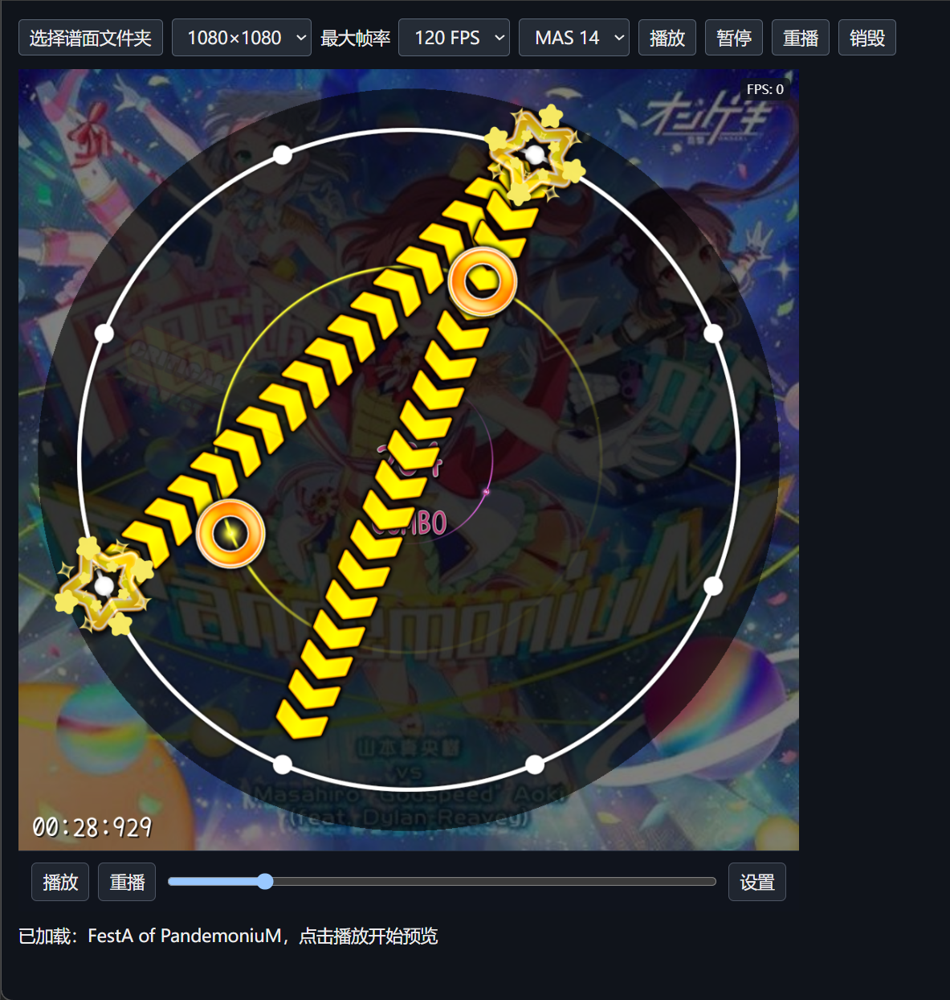
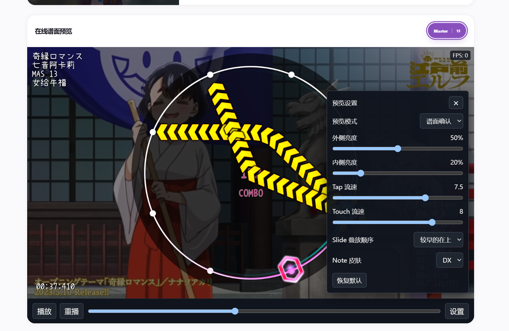

# MiaView_Web

MiaView_Web 是一个可嵌入网站的 maimai 谱面实时预览库，支持 Simai 格式，基于 [MiaCode](https://github.com/Team-MiaCode/MiaCode) 的原生解析器和预览场景实现。

通过这个库，你可以在谱面网站或在线看谱器中加入实时播放器，查看谱面并播放音乐、判定音效。播放器通过 WebAssembly 运行原生代码，使用 Qt Quick 和 WebGL 2 绘制画面，使用 WebAudio 播放音频。

当前基于 [MiaCode v1.2.0](https://github.com/Team-MiaCode/MiaCode/releases/tag/v1.2.0) 版本进行开发。

## 功能

- 加载 `maidata.txt`，支持谱面原文、本地文件和网络 URL。
- 搭配音乐、背景图片或 PV 视频进行实时预览。
- 播放、暂停、跳转、重播和切换难度。
- 调整音符流速和画面亮度，切换 SD / DX 皮肤与预览模式。
- 支持 16:9 与 1:1 画面，提供 ES module 接口和 TypeScript 类型声明。
- 可配置最大预览帧率，支持不小于 30 的整数或不限帧率，默认 60 FPS。

仓库提供可直接部署的预编译播放器，接入时无需编译 C++。本库专注于浏览器中的谱面预览，不包含 MiaCode 桌面版的完整编辑器和视频导出功能。

## 效果展示

本地示例页中的 1:1 谱面预览：



嵌入实际网站的 16:9 谱面预览，图中同时展示了预览设置面板：



## 本地试用

安装 Node.js 22 或更高版本，然后运行：

```sh
git clone https://github.com/teleaki/MiaView_Web.git
cd MiaView_Web
npm run dev
```

无需执行 `npm install`。启动后，在浏览器中打开 <http://localhost:3030>，选择包含 `maidata.txt` 的谱面文件夹，加载完成后点击播放。文件夹可以同时包含音乐、背景图片和 PV；所选文件只在浏览器中读取，不会上传到示例服务器。

示例服务器仅监听本机地址，用于本地开发。正式部署请使用静态托管服务。

示例页顶部提供分辨率和「最大帧率」下拉框，可直接调整本地预览：

| 选项 | 可选值 | 默认值 |
| --- | --- | --- |
| 分辨率 | 1920×1080（16:9）、1080×1080（1:1） | 1920×1080 |
| 最大帧率 | 30、60、90、120、144、165、240 FPS、不限 | 60 FPS |

切换任一选项后，示例页会自动重新创建播放器并加载当前谱面，回到起点并暂停，点击「播放」即可继续预览。「不限」表示取消程序限帧，实际帧率取决于屏幕刷新率、浏览器调度和设备性能。

示例会按扩展名选取首个音乐、图片和视频文件。如果文件夹中有多个同类素材，请通过接入接口明确指定要使用的文件。

## 接入自己的网站

### 1. 部署 SDK 和播放器

将完整的 `sdk/` 和 `renderer/` 目录复制到网站的静态资源目录，例如：

```text
public/
└── miacode/
    ├── sdk/
    └── renderer/
```

部署后应能访问 `/miacode/sdk/index.mjs` 和 `/miacode/renderer/index.html`。请保留 `renderer/` 中的全部文件，包括 JS、WASM、音效、构建清单和许可文件。

当前未发布 npm 包，可直接按上述静态目录方式接入。

### 2. 创建播放器并加载谱面

```html
<div id="preview" style="width: 100%; max-width: 960px"></div>
<p id="status" role="status"></p>

<script type="module">
  import { createPreview } from "/miacode/sdk/index.mjs";

  const status = document.getElementById("status");
  const preview = createPreview(document.getElementById("preview"), {
    rendererUrl: "/miacode/renderer/index.html",
    resolution: { width: 1920, height: 1080 },
    maxFps: 60, // 可选：不小于 30 的整数，或 "unlimited"
  });

  preview.on("error", ({ message }) => {
    status.textContent = message;
  });

  try {
    await preview.ready;
    const info = await preview.load({
      maidata: { url: "/charts/example/maidata.txt" },
      audio: "/charts/example/track.mp3", // 可选
      cover: "/charts/example/cover.jpg", // 可选
      video: "/charts/example/pv.mp4",    // 可选；提供后使用视频背景
      difficulty: 5,                     // 可选；省略时选择已有的最高难度
    });
    status.textContent = `已加载：${info.title}，点击播放器内的播放按钮开始`;
  } catch (error) {
    status.textContent = error.message;
  }

  window.addEventListener("pagehide", () => preview.destroy(), { once: true });
</script>
```

将示例中的谱面和媒体路径替换为你自己的资源地址。播放器加载完成后默认暂停；点击内置播放按钮即可开始预览，也可以通过进度条跳转或在设置面板中调整画面。首次播放音频需要用户操作，以满足浏览器的自动播放限制。

`maxFps` 设置最大预览帧率，默认 60，可配置为不小于 30 的整数（如 30、60、120、144、240），或 `"unlimited"` 取消程序限帧。实际帧率受屏幕刷新率、浏览器调度和设备性能影响；右上角的 FPS 显示实际绘制帧率，暂停时可能为 0。与分辨率一样，修改最大帧率需要销毁并重新创建实例，当前配置可通过 `(await preview.getState()).maxFps` 读取。

接入自己的网站时，在 `createPreview()` 的配置中设置 `maxFps`；本地示例页的「最大帧率」下拉框也是通过这个参数控制帧率。代码配置支持任意不小于 30 的整数，不限于示例页列出的档位。

```js
const preview = createPreview(document.getElementById("preview"), {
  resolution: { width: 1920, height: 1080 },
  maxFps: "unlimited",
});
```

直接嵌入播放器 HTML 时，也可以在 URL 中配置，例如 `/miacode/renderer/index.html?width=1920&height=1080&maxFps=120`。

### 3. 使用本地文件或谱面原文

`maidata` 接受谱面原文或 `File` / `Blob`；加载网络谱面时，请使用 `{ url }`。音乐、图片和视频既可以传入 HTTP(S) URL，也可以传入 `File` / `Blob`。

```js
// 直接预览谱面原文，不提供音乐也可以运行。
await preview.load({
  maidata: "&title=Example\n&artist=Example\n&first=0\n&inote_5=(120)1,2,3,4,E",
  difficulty: 5,
});

// maidataFile 和 musicFile 为文件选择器取得的 File 对象。
await preview.load({ maidata: maidataFile, audio: musicFile });
```

音乐和背景需要由接入方单独传入，模块不会自动读取谱面中的素材路径。

## 常用接口

先等待 `preview.ready` 完成，再调用接口。播放、暂停和跳转等操作需要先成功加载谱面。

| 接口 | 用途 |
| --- | --- |
| `load(input)` | 加载谱面及媒体，完成后回到起点并暂停 |
| `play()` / `pause()` | 播放 / 暂停 |
| `seek(second)` | 跳转到指定秒数 |
| `restart()` | 从头重新播放 |
| `selectDifficulty(id)` | 切换已有难度，编号为 1–7 |
| `setSettings(settings)` | 修改预览设置 |
| `getState()` | 获取播放位置、难度和设置等状态 |
| `on(event, listener)` | 订阅事件，返回取消订阅函数 |
| `destroy()` | 销毁播放器并释放资源 |

除 `on()` 和 `destroy()` 外，上表中的接口均返回 Promise，请使用 `try` / `catch` 配合 `await`，或通过 `.catch()` 处理错误。

```js
await preview.setSettings({
  tapFlowSpeed: 8,        // 1–10
  touchFlowSpeed: 8,      // 1–10
  outerBrightness: 0.5,  // 0–1
  innerBrightness: 0.2,  // 0–1
  noteSkin: "DX",        // "SD" 或 "DX"
  previewMode: "native", // "native"、"maimuri_dx_style" 或 "erase_by_area"
});

const unsubscribe = preview.on("paused", ({ elapsedMs }) => {
  console.log("暂停位置：", elapsedMs, "毫秒");
});
```

完整的参数、返回类型和事件定义见 [sdk/index.d.mts](sdk/index.d.mts)，示例代码见 [examples/demo.mjs](examples/demo.mjs)。在 React、Vue 等框架中使用时，请在组件挂载后创建实例，并在组件卸载时调用 `destroy()` 释放资源。

## 部署注意事项

- 正式部署使用 HTTPS，本地开发使用 localhost；不能通过 `file://` 直接打开。
- 浏览器需要支持 WebAssembly、WebGL 2 和 WebAudio。音视频能否播放取决于浏览器支持的编码格式。
- 渲染分辨率的宽高需为正整数，比例必须为 16:9 或 1:1，单边不超过 4096，例如 1280×720、1920×1080 或 1080×1080。修改分辨率需要销毁并重新创建实例。
- 静态服务器需正确返回 `.js` / `.mjs` 和 `.wasm` 文件的 MIME 类型，其中 WASM 应为 `application/wasm`。
- 跨域部署时，播放器服务器需允许宿主来源的 CORS，素材服务器需允许播放器来源的 CORS；同时允许 iframe 嵌入。
- 网络素材请求不携带 Cookie。需要鉴权的素材可由宿主获取后传入 Blob，或提供有效的签名 URL。
- 更新播放器时，请完整部署 `renderer/`，避免混用不同版本的 JS、WASM 和清单。
- 多个播放器实例会分别占用内存与 GPU 资源，不再使用时请调用 `destroy()`。

## 开发与构建

```sh
npm test       # SDK 与消息协议测试
npm run check  # 产物哈希和上游存档完整性检查
```

修改原生代码或内嵌素材后，需要重新构建播放器。当前构建脚本面向 Linux，依赖 Node.js 22+、CMake 3.24+、Ninja、Qt 6.8.3 的 `wasm_singlethread` 和同版本 `gcc_64` 主机工具，以及已激活的 Emscripten 3.1.56。Qt 组件包含 Core、Gui、Quick、Svg 和 ShaderTools。

```sh
MIACODE_QT_ROOT=/path/to/Qt/6.8.3 \
MIACODE_EMSDK_ROOT=/path/to/emsdk \
MIACODE_BUILD_JOBS=1 \
npm run build:native
npm run check
```

构建脚本会更新播放器文件、构建身份和哈希清单。若需在真实浏览器中验证加载与播放流程，可运行 `npm run test:browser`；运行前需另行准备 Playwright 和 Chromium。

## 友链与致谢

- [MiaCode](https://github.com/Team-MiaCode/MiaCode)：基于 Qt / C++ 的 maimai 谱面创作工具，提供谱面编辑、实时预览、无理检测和视频导出等功能。本库的原生解析器和预览场景来源于 MiaCode，感谢上游作者及所有贡献者。

## 许可说明

上游源码的 MIT 许可证、资源许可范围和第三方声明分别保留在 [native/upstream/LICENSE](native/upstream/LICENSE)、[LICENSE_SCOPE.md](native/upstream/LICENSE_SCOPE.md) 和 [THIRD_PARTY_NOTICES.md](native/upstream/THIRD_PARTY_NOTICES.md) 中，播放器目录也保留了相应文件。

上游源码的 MIT 许可不覆盖所有字体、音效、皮肤或 Qt 运行时。本库尚未完成独立的公开发布许可审核，使用或再分发时请核对各组件的适用条款。
