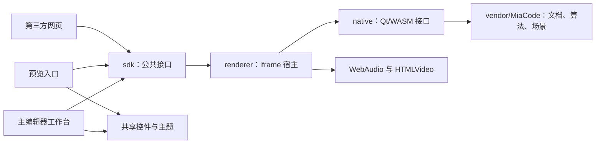

# 网页编辑器迁移计划

记录日期：2026-10-13。工作分支：`feature/web-editor-migration`。

## 目标与基准

在 MiaView_Web 的现有架构上构建网页版谱面编辑器。MiaCode_v2 提供界面、字段和本地功能基准；vscode.dev 提供浏览器工作台的组织与交互参考。Stage1 的入口为可运行的雏形模板，正式交付分为 UI 迁移、功能接入、预览优化、独立编辑器与预览区交付四个 stage。每个 stage 自行迭代至验收达标，完成后推送一次 feature 分支。

全项目 UI 准确度以 85% 为门槛，每个页面及整体评分均达到 85 分；布局安全、输入对齐和操作可达性逐项通过。功能按本地业务清单逐项可用，核心创作流程通过率为 100%。

| 基准 | 核对结果 | 计划用途 |
| --- | --- | --- |
| MiaView_Web | 起点提交 `a4983e1`；原生 HTML/CSS、ES modules、iframe SDK、Qt Quick/WASM/WebGL 2、WebAudio | 主项目架构与浏览器运行链路 |
| 上游预览源码 | `vendor/MiaCode` 固定提交 `ff9f65856b8591589aba0582ac867220202a44c6` | 解析、文档、变换、分析和场景的源码来源 |
| 本机 MiaCode_v2 | `MiaCode_v2` 的 `dev`，提交 `8770413f965084f2e0567ae44c235b8a34377861` | UI、命令、文档保存语义和预览质量基准 |
| 工具链 | Node.js 22+；Qt 6.11.1；Emscripten 4.0.7；`wasm_singlethread` | 复现现有构建 |
| 构建约定 | `build-devtools/`；Release；构建并发上限 4 | 本机与 CI 的统一配置 |

本机 v2 与固定上游属于两个源码基准。雏形模板登记页面与状态基准；Stage1 以 v2 的 QML、主题和图标建立迁移表；Stage2 按固定上游核对可消费模块及命令；Stage3 使用同一组谱面和时间点对齐 v2；Stage4 保留主项目编辑器，复制生成独立编辑器与独立预览子项目。版本更新记录确切提交与变更原因。

业务验收覆盖文档、谱面编辑、分析、时间轴、播放、偏好设置、BPM 与延迟检测、素材载入、封面和视频导出。视频导出按单个难度及选定区间执行。工具箱范围依据 `ActivityBar.qml` 的工具菜单：谱面整理、音轨前补空白、采样率转换、PV 前补黑屏、PV 对齐音乐、PV 压缩与批量压缩。用户授权省略这组功能的迁移，Stage1–Stage4 的交付与验收按上述业务范围执行；net 内容沿用用户指定的范围约定。

## 架构与阶段目录

网页界面使用现有 HTML/CSS 与原生 ES modules。文档和谱面算法通过现有 WASM 宿主接入，预览沿用 Qt Quick/WebGL 2，音频沿用 WebAudio，媒体沿用浏览器文件与视频接口。新模块按现有职责边界扩展。



主项目使用以下职责布局。现有运行链路沿用 `sdk/`、`renderer/`、`native/` 与 `backend/`，工作台组件按职责接入。Stage4 保留主入口与主项目源文件，并增加独立子项目。

```text
MiaView_Web/
├── index.html                     # 主编辑器入口
├── app.mjs                        # 工作台装配
├── page.css                       # 工作台布局
├── ui/
│   ├── workbench/                 # 编辑、侧栏、时间轴与功能页
│   └── components/                # 公共控件、主题与图标
├── services/                      # 文件、偏好与文档命令接入
├── sdk/                           # 现有公共 SDK
├── renderer/                      # 现有 iframe、播放与媒体宿主
├── native/                        # 现有 Qt/WASM 构建与桥接
├── backend/                       # 现有诊断日志服务
├── examples/                      # 现有预览与嵌入示例
├── vendor/MiaCode/                # 固定版本的共享源码
├── dev/                           # 开发服务与诊断入口
├── scripts/                       # 构建、主题同步、验证与打包
├── tests/                         # 现有测试及本次受影响契约
├── docs/
├── build-devtools/                # Release 构建目录
└── artifacts/                     # 阶段交付包
```

主编辑器调用 `sdk/index.mjs`。`createPreview()`、`load()`、播放控制、设置和事件均由现有公共接口提供。Stage4 的独立编辑器与独立预览使用各自包内的 SDK 副本，接口、主文件名、算法、构建身份和资源版本来自同一权威源码。

各阶段按最终职责编写组件与服务，雏形模板、正式工作台和 Stage4 子项目沿用同一实现。复制与同步通过长期维护的生成脚本执行，各交付产物记录对应源码版本与资源哈希。独立子项目的代码、资源、配置和构建依赖在各自目录内闭合。

### 状态与接口规则

- 文档采用 v2 `ChartWorkspace` 的单一所有者与事务语义。复用 `sourceText`、`activeDifficultyId`、`revision`、`dirty`、`dirtyDifficultyIds`、`documentOpenGeneration` 和保存点接口；DOM 编辑控件持有输入缓冲、选区与撤销记录，业务页读取文档快照。
- 界面复用 `activeEditorKey`、`openEditorTabs`、`editorHistory`、`activeSidebarView`、`sidebarVisible`、`bottomPanelVisible`、`compactPanel` 等状态名称；标签标识沿用 `difficulty:<id>`、`metadata`、`latency`。
- 布局复用 `sidebarWidth`、`previewWidthRatio`、`bottomPanelHeightRatio`、`previewOnLeft`、`previewCanvasFreeAspect` 等偏好。拖动期间更新临时几何，结束时持久化。
- SDK 继续使用 `maidata`、`audio`、`cover`、`video`、`difficulty` 和 `currentTime`、`duration`、`difficultyId`、`settings`、`resolution`。新增能力在同一协议、类型和构建身份中登记。
- 打开操作选择整个谱面文件夹，保留目录文件清单，并根据 `ChartAssetPaths.h` 的命名关系载入同目录的 `maidata.txt`、`track.*`、`bg.*` 与 `pv.*`。集合目录先确定当前谱面，再按该谱面的目录绑定素材。
- 异步结果沿用 revision、generation、sequence 核验；文档切换、解析、分析、保存和播放引用对应文档版本。
- 浏览器尺寸属于布局层，`resolution` 属于渲染层；画布、PV、HUD、点击坐标共用同一变换。

## 前置：可运行的雏形模板

雏形模板作为 Stage1 的输入与正式工作台基础，使用当前架构、现有字段和公共接口。

| 编号 | 工作 | 交付与完成条件 |
| --- | --- | --- |
| T-01 | 准备运行链路 | 初始化固定上游，获取或构建同版本 renderer，主入口通过现有开发服务与静态部署加载 |
| T-02 | 建立工作台骨架 | 顶部菜单与工具栏、活动栏、侧栏、编辑标签、文本输入区、预览容器、底部面板、状态栏具备对应组件 |
| T-03 | 建立基础交互 | 标签切换、侧栏/底部面板折叠、分栏拖动、主题切换、文本输入和设置面板进入正式状态模型 |
| T-04 | 接入现有预览 | 通过 `createPreview()` 挂载实际 renderer，使用现有谱面样本完成加载、播放、暂停与跳转 |
| T-05 | 登记视觉与功能基准 | 记录 v2 源码与参考页面状态、组件映射、命令 id、视口矩阵与 UI 评分项目 |

模板验收覆盖桌面、窄屏和矮窗口的主区域排列与基础操作。模板输出包含可运行入口、组件骨架、实际预览接入和基准记录；组件持续用于 Stage1–Stage4。模板与 Stage1 使用同一提交节点。

## Stage1：迁移 UI 与适配浏览器布局

### 工作包

| 编号 | 工作 | 具体交付 |
| --- | --- | --- |
| S1-01 | 建立 UI 对照表 | 对照 v2 `MainView`、`MainSplitView`、`ActivityBar`、`Sidebar`、`EditorPane`、`PreviewPane`、`BottomPanel`、菜单、状态栏及各功能页，记录网页组件和字段映射 |
| S1-02 | 接入工作台构建与页面入口 | 更新开发服务、Pages 打包与 CI 的主工作台入口，沿用现有 SDK/renderer 路径；native 默认构建目录设为 `build-devtools/` |
| S1-03 | 迁移主题与公共控件 | 扩展现有 `sync-theme.mjs`，同步 v2 色板、排版、间距、圆角、分隔线、难度颜色和 SVG；主工作台与预览使用共同样式 |
| S1-04 | 迁移主工作台细节 | 在雏形组件上对齐顶部菜单与工具栏、活动栏、谱面侧栏、编辑标签、文本区域、预览面板、时间轴/分析标签、状态栏和欢迎页 |
| S1-05 | 迁移功能页面 | 元数据、难度管理、偏好、播放设置、BPM/延迟、视频导出和封面编辑的界面与导航 |
| S1-06 | 接入布局交互 | 分栏拖动、面板折叠、编辑器与预览左右交换、标签切换、弹窗和菜单定位、主题切换、布局偏好保存 |
| S1-07 | 迁移工作台预览面板 | 对齐 v2 `PreviewPane`、`PreviewTransport` 与音符统计，接入画布比例、播放区、设置、难度与全屏入口 |

v2 决定产品内容、主题与控件外观。vscode.dev 的活动栏、主侧栏、编辑标签、底部面板和状态栏提供浏览器工作台组织参考，见 [VS Code 界面说明](https://code.visualstudio.com/docs/editing/getting-started/userinterface)。

界面几何使用 v2 `Theme.qml` 的现有值作为起点：UI 字号 13、活动栏宽度 48、工作区标题高度 34、控件最小高度 30、分隔线 1、分隔线命中范围 9。浏览器缩放通过布局计算传播，字号和控件偏好按实际用户配置更新。

### 布局策略

1. 工作台使用 CSS Grid/Flex 与内容最小尺寸分配空间；编辑区、侧栏、时间轴和功能页分别管理滚动。
2. 宽屏显示侧栏、编辑区和预览分栏；中等宽度依据面板最小尺寸折叠侧栏或切换预览位置；窄屏使用编辑/预览切换与抽屉面板。
3. 矮屏依据可用高度折叠底部面板，预览依据容器的宽高共同拟合。弹窗和设置面板控制高度并提供内容滚动。
4. 预览以 `ResizeObserver` 获取实际容器尺寸。SDK 与 renderer 共享控制区高度和舞台拟合规则；现有固定 80px 控制区随控件布局调整为实际尺寸契约。
5. 常规网页嵌入使用比例布局，工作台嵌入使用容器布局。16:9 与 1:1 渲染画面在各类容器中保持几何比例。
6. 长标题、长路径、多个标签、中文组合输入、菜单靠近边缘和虚拟键盘均有布局用例。折叠面板持续保留对应入口与键盘焦点。

### 验收矩阵

| 维度 | 覆盖样本 |
| --- | --- |
| 窄屏与竖屏 | 320×568、360×800、390×844、768×1024、1080×1920 |
| 小窗口与矮屏 | 640×360、800×600、1024×600、1280×720 |
| 桌面与超宽 | 1366×768、1920×1080、2560×1080、2560×1440、3440×1440 |
| 缩放 | 50%、75%、100%、125%、150%、200% |
| 像素密度 | DPR 1、1.25、1.5、2、3 |
| 布局状态 | 侧栏展开/折叠、底部面板展开/折叠、左右交换、分栏边界、主题切换、设置弹窗 |
| 浏览器 | 当期稳定版 Chrome、Edge、Firefox、Safari；记录验证版本 |
| 预览容器 | 方形、横向、纵向与矮容器；16:9/1:1；分栏拖动与容器连续缩放 |

固定样本结合布局函数的边界用例覆盖连续尺寸变化；验收以容器尺寸和内容约束为依据。

### UI 准确度与自行迭代

UI 评分以 v2 的外观、字段和组件为主基准，浏览器工作台组织采用 vscode.dev 的面板关系。雏形阶段固定参考版本、页面、主题、内容和尺寸；窄屏适配按对应布局方案评分。

| 评分项 | 权重 | 核对内容 |
| --- | --- | --- |
| 布局与几何 | 35 | 区域顺序、位置、尺寸、间距、分隔线与内容对齐 |
| 字体与排版 | 20 | 字体、字号、字重、行高、文字基线、换行与截断 |
| 色彩与层次 | 15 | 主题色、背景层次、边框、强调色、难度色与状态色 |
| 控件与状态 | 20 | 按钮、输入框、标签、菜单、弹窗、圆角以及交互状态 |
| 图标与细节 | 10 | v2 图标、大小、位置、线条和细节间距 |

每项按匹配的有效检查项目计算分值，页面分数为五项分数之和；整体分数按固定的页面与状态权重计算。每个页面及整体分数均达到 85 分。功能正确性与关键布局条件分别验收。计分容差、记录表和基准选择见 [UI 验收基准](WEB_EDITOR_UI_ACCEPTANCE_ZH.md)。

迭代流程为 `实现 → 指标验证 → 定位差异 → 修复 → 受影响用例复验 → 阶段验收`。每轮记录页面、差异位置、得分、修改与复验结果。执行期间自行完成实现选择与修复；验证通过后进入后续工作包，阶段完成条件决定上传节点。

Stage1 完成条件：

- 对照表中的界面、导航与布局交互具备对应实现。
- 每个页面及整体 UI 准确度达到 85%；视觉评分与关键布局条件均有可复核记录。
- 每个矩阵用例中，控件处于对应面板范围，面板相邻边界误差在 1 CSS px 内；阅读区域具有对应滚动方式。
- 编辑输入、行号与装饰层共用字体和滚动坐标；缩放、换行与中文输入保持对齐。
- 预览圆形舞台、PV、HUD 和操作坐标使用一致比例；菜单、弹窗与焦点处于可操作区域。
- 分栏尺寸、主题与标签状态在缩放、切换布局和恢复窗口后保持一致。
- 主工作台和现有预览链路由统一源文件构建，生成包可从域名根路径与项目子路径加载。

Stage1 交付持续使用的雏形组件、主工作台、UI 对照表、85% 准确度评分、布局矩阵结果与静态站点包。

## Stage2：接入功能并验证正确性

### 接入顺序

`文档事务与保存 → 编辑命令 → 解析/分析/时间映射 → 播放与预览同步 → 偏好与素材 → BPM/延迟 → 媒体处理与导出 → 完整创作流程验收`。

### 功能清单

| 功能组 | 接入内容 | v2/现有实现依据 | 验收重点 |
| --- | --- | --- | --- |
| 文档与文件 | 新建、打开、拖入素材、最近项目、保存、保存全部、另存为、自动保存与恢复、关闭提示 | `ChartWorkspace`、`ChartWorkspaceFileService`、现有本地 `File/Blob` 加载 | 文件往返、额外字段保留、保存点、单难度与全项目保存语义 |
| 元数据与难度 | title/artist/first、等级、谱师、统一谱师、扩展字段、难度增删与切换 | `SimaiDocument`、`DocumentModel`、`DifficultyOptions` | 字段与正文一致，难度 id 和保存范围一致 |
| 文本编辑 | 行号、高亮、选择、撤销/重做、复制粘贴、查找替换、换行、覆盖输入、中文输入策略、全角转换 | `ScintillaDslStyler`、`SimaiTextEditPolicy`、`EditorController` 的行为与命令 | Unicode、输入事务、光标/选区、每个难度的撤销记录 |
| 编写辅助 | 时值补全、Touch 编写、书签、选区拍数、快捷键与命令入口 | `SimaiCompletionCatalog`、`TouchPadAuthoringEdit`、`BookmarkCommentSyntax`、`ChartSelectionBeatSummary` | 同一输入与 v2 得到相同文本修改和选区结果 |
| 谱面变换 | 左右/上下镜像、旋转、细分拍调整、Break/EX/烟花切换、摆键重置、清空指定元素 | `ChartBatchTransform`、`ChartTransformCommands` | 操作 id、选区上下文、时间语义和撤销一致 |
| 语法与分析 | 解析错误、错误定位、无理检测、分析列表与预览覆盖层 | `SimaiParser`、`MuriAnalyzer` 与相关模型 | 错误位置、严重程度、分析结果与所用 revision 一致 |
| 时间轴 | 音符轨道、音乐波形、播放指针、缩放、滚动、跳转、选区联动 | `TimelineData`、`TimelineMarkerOffset`、`TimelineModel` | first、BPM、变速和正文位置映射一致 |
| 播放与预览 | 播放、暂停、停止、跳转、重播、区间播放、倍率、音量、音效、难度切换、皮肤、预览模式与统计 | 现有 `player-controller`、`player-engine`、`runtime`、预览设置 | 时间状态、切换时资源释放、正文更新与播放位置协调 |
| 偏好与素材 | 主题、字体、编辑设置、布局、音乐、封面、PV、自定义背景与素材替换 | `WorkbenchSettings`、偏好模型、现有资源接口 | 字段同名、保存与恢复、素材替换后的文档与播放状态 |
| BPM 与延迟 | 波形、BPM 检测、节拍参考、clock_count、first 校准、结果回写 | `LatencyModel` 与 `runtime/latency` | 检测样本、单位、时间基准与回写字段 |
| 封面与视频 | 封面图层编辑与输出；区间、片头、PV、判定音、分辨率与帧率配置；预览视频输出 | 封面/导出页、共享场景与显式帧时间 | 文件可播放、画面帧序、音轨时长、区间和设置一致 |

各功能组落地时建立命令清单，记录 v2 标识、网页入口、实现位置和验收用例。清单随代码维护。每项可用性以真实业务结果、保存或输出结果、任务状态和取消/恢复行为为依据。

### 实现边界

- 文档操作在 WASM 内复用 `ChartWorkspace`，通过现有 SDK 协议暴露快照与事务；现有 `loadedDocument` 由同一文档所有者提供。浏览器文件句柄和素材引用由宿主文件服务管理。
- 固定上游具备 `miacode_chart`、`miacode_analysis` 及相关核心源码；`miacode_editor_core` 当前位于桌面构建条件内。Stage2 通过 native 的消费入口装配所需核心源文件与资源，记录依赖，复用 v2 命令名与算法。
- 文本区域使用网页编辑控件承担 DOM 输入、选区、装饰层与滚动；补全、变换、书签语义、拍数与权威诊断消费共享核心。
- 解析更新、媒体加载和播放命令区分各自职责。正文变化按 revision 更新谱面；音乐、PV 和音效资源复用现有加载结果。
- 文件读取采用 `File/Blob`；原位保存使用浏览器提供的文件句柄；保存下载与恢复采用浏览器文件输出和 IndexedDB。文件句柄能力依据浏览器支持登记，见 [File picker 文档](https://developer.mozilla.org/en-US/docs/Web/API/Window/showSaveFilePicker)。
- 素材解码与导出建立浏览器适配模块。音频与视频消费 WebAudio/WebCodecs，容器输出使用对应封装模块；任务使用现有后台任务接口，依赖与资源随项目部署。
- 视频导出以显式时间驱动现有 Qt 场景并确认帧完成，编码消费对应帧；音轨使用同一时间基准。编码配置通过 `isConfigSupported()` 检查并记录可用输出格式，见 [WebCodecs](https://developer.mozilla.org/en-US/docs/Web/API/WebCodecs_API) 与 [配置检测](https://developer.mozilla.org/en-US/docs/Web/API/VideoEncoder/isConfigSupported_static)。

### 验收

1. 建立固定谱面集，覆盖 Tap/Hold/Slide/WiFi/Touch/TouchHold、Break/EX/烟花、变速、负 first、多个难度、注释、扩展字段、空难度及语法错误。
2. 对文档、补全、变换、选区拍数、诊断和无理结果做 v2 与 Web 的同输入比较；输出文本、字段、错误位置与时间结果逐项核对。
3. 验证“打开 → 编辑 → 切换难度 → 撤销 → 分段保存/保存全部 → 恢复 → 分析 → 区间播放 → 导出”的完整流程。
4. 验证连续输入、中文组合输入、快速难度切换、解析完成顺序、素材替换、保存期间输入、任务取消和刷新恢复。
5. 对素材载入与导出建立时长、帧数、音轨和可播放性用例，包含短样本与三分钟样本；登记浏览器、编码格式与设备。
6. 主工作台与现有预览入口共用 SDK；同谱面、同设置、同时间的预览状态一致。
7. 每个功能组自行迭代至清单用例通过，并复核受影响页面的 UI 得分与布局条件。

Stage2 完成条件：各功能组及对应命令逐项可用，正确性用例与核心创作流程通过率 100%，影响编辑、保存、解析、同步和导出的阻断缺陷数量为 0；UI 准确度保持每页及整体 85%；浏览器能力与可用格式有明确记录。

## Stage3：预览达到 v2 的质量基准

### 工作包

| 编号 | 工作 | 对齐内容 |
| --- | --- | --- |
| S3-01 | 画面与场景 | 音符几何、轨迹、颜色、SD/DX 皮肤、判定效果、烟花、图层顺序、Muri 覆盖层、统计和 HUD |
| S3-02 | 画布与媒体 | v2 的方形与自由画布配置、宽屏 HUD、PV 裁切、亮度、背景、缩放与点击坐标；工作台和现有预览入口使用相同规则 |
| S3-03 | 播放时间 | WebAudio 时间源、倍率、暂停恢复、跳转、区间循环、音效调度、PV 同步、切回前台的状态恢复 |
| S3-04 | 性能 | 解析/分析缓存、场景与纹理复用、烟花预热、批绘制、JS/WASM 数据传递、控制区更新、隐藏表面的渲染生命周期 |
| S3-05 | 预览回归与迭代 | 对齐各类谱面、设置与播放状态，按采样结果修复画面、时间和性能差异，复验对应编辑及导出流程 |

沿现有 `diagnostics` 与性能报告记录加载耗时、真实呈现帧率、帧时间分位值和播放间隙；每项优化对应具体采样与结果。

### 验收标准

- 选择固定参考设备，记录 CPU/GPU、浏览器、v2 版本、分辨率和谱面。普通、密集、长曲、烟花密集及 PV 样本分别形成基线。
- 同谱面、同设置、同显式时间点的音符位置误差在 1 个逻辑像素内；音符数量、轨迹状态、层序、HUD 与统计数值一致。抗锯齿和字体结果按对应区域核对。
- 1080P、60 FPS 模式下，参考设备有效呈现帧率达到 57 FPS，帧时间 p95 在 20ms 内；记录 1:1、16:9、自由画布和 PV 下的结果。
- 60 FPS 模式的预览/PV 时间偏差在一帧内；暂停、跳转、倍率切换和循环后保持时间关系。音效调度使用音频时钟记录独立测量结果。
- 编辑输入响应 p95 在 100ms 内；重复播放、难度切换、素材替换与创建/销毁实例后，活动监听器、纹理、音频节点和 Blob URL 回到对应活动资源数量。
- 预览优化后，各功能组的业务用例与核心创作流程保持通过；每页及整体 UI 准确度保持 85%。

Stage3 交付 v2 对比结果、性能记录、同步测量、UI 评分和功能回归结果。

## Stage4：复制交付独立编辑器与预览区

Stage4 保留主项目编辑器及其原入口，从主项目源码复制生成 `editor/` 独立编辑器和 `preview/` 独立预览区，供网页创作者部署与嵌入。两种子项目延续主项目架构、主文件、字段、协议、主题与构建身份；各自运行、安装、构建与部署均以子项目目录为根。

### 目标目录

```text
MiaView_Web/
├── index.html                     # 主编辑器页面入口
├── app.mjs                        # 主项目工作台装配
├── page.css                       # 主项目工作台布局
├── ui/                            # 主项目组件、主题与图标
├── services/                      # 主项目文件、偏好与文档接入
├── sdk/
├── renderer/
├── native/
├── backend/
├── vendor/MiaCode/
├── editor/
│   ├── index.html                 # 独立编辑器入口
│   ├── app.mjs                    # 同版本工作台装配
│   ├── page.css                   # 同版本工作台布局
│   ├── ui/                        # 编辑、主题与公共控件的包内副本
│   ├── services/                  # 文件、偏好与文档接入的包内副本
│   ├── sdk/                       # 编辑器接入与预览 SDK
│   ├── renderer/                  # 配套预览运行资源
│   ├── native/                    # 子项目构建入口与桥接源码
│   ├── vendor/MiaCode/            # 固定上游源码与身份
│   ├── backend/                   # 可选诊断服务
│   ├── scripts/                   # 子项目构建、验证与打包
│   ├── tests/
│   ├── package.json
│   ├── tsconfig.json
│   └── README.md                  # 部署、嵌入和开发说明
├── preview/
│   ├── index.html                 # 独立预览页面入口
│   ├── app.mjs
│   ├── page.css
│   ├── sdk/                       # index.mjs、index.d.mts 与现有协议
│   ├── renderer/                  # player、runtime 与浏览器媒体宿主
│   ├── native/                    # browser-host.cpp、CMakeLists.txt 与构建桥接
│   ├── ui/                        # 预览控件、主题和图标的包内副本
│   ├── backend/                   # 可选诊断日志服务
│   ├── vendor/MiaCode/            # 固定上游源码与身份
│   ├── scripts/                   # 子项目构建、验证与打包
│   ├── tests/
│   ├── examples/                  # 第三方静态嵌入示例
│   ├── package.json
│   ├── tsconfig.json
│   └── README.md                  # 接入与部署说明
├── dev/
├── scripts/
├── tests/
├── docs/
├── build-devtools/
└── artifacts/                     # 主站、独立编辑器、独立预览交付包
```

### 工作包与验收

| 编号 | 工作 | 验收重点 |
| --- | --- | --- |
| S4-01 | 复制独立编辑器 | 主项目编辑器持续使用原入口；`editor/` 包含同版本工作台、服务、主题、资源、SDK 与配套预览，覆盖完整编辑流程 |
| S4-02 | 复制独立预览 | `preview/` 包含同版本 SDK、renderer、native、控件、主题与资源，以独立入口提供预览 |
| S4-03 | 完成自包含构建 | 子项目具备自身 package、类型配置、构建与验证脚本、固定上游源码、依赖清单和构建身份，路径按子项目根目录解析 |
| S4-04 | 维护生成与同步 | 生成脚本从主项目权威源码复制对应文件，核对公共文件名、接口、资源版本与哈希，主项目和两种子项目同步迭代 |
| S4-05 | 完成网页接入 | 独立编辑器和预览分别提供静态页面与 ES module 接入示例，覆盖加载、命令/播放、状态、事件和销毁；接口复用主项目命令与字段 |
| S4-06 | 完成隔离验收 | 单个子文件夹复制至工作区外，执行依赖准备、Release 构建、静态服务、功能、UI 与资源加载用例，验证包内依赖闭合 |

运行交付包含各自功能所需 SDK、renderer、UI、WASM、音效、主题、图标、媒体、构建身份与许可文件；源码交付包含各自配置、构建脚本、native、固定上游和依赖清单。相对路径以子项目内对应文件为基础解析，生成资源随包交付。构建工具依赖按子项目清单准备，默认依赖目录与 `build-devtools/` 均位于子项目内。

自包含验收逐项核对 ES module 导入、HTML/CSS 资源、WASM 与 Qt 资源、Worker、动态 URL、类型引用、脚本调用、CMake 路径和源码身份。解析后的文件路径、符号链接与资源请求均在子项目范围内。验收环境仅放置该子项目与其声明的工具依赖，记录安装、构建与服务的工作目录及结果。

网页接入覆盖域名根目录、项目子路径、同页多个实例、不同来源 iframe 的协议校验，以及方形、横向、纵向和矮容器。主编辑器与独立编辑器在同输入下得到一致文档、命令和保存结果；三种入口的同谱面、设置和时间预览一致。Stage2 功能清单、Stage3 预览指标、每页及整体 85% UI 准确度保持达标。

Stage4 交付保留的主项目编辑器、独立编辑器子文件夹、独立预览子文件夹、三种产品交付包、子项目配置与构建入口、公共类型与接入示例、版本一致性和隔离验收记录。

## 自行迭代与验收记录

每个工作包完成一个可运行结果，使用对应视觉评分、功能样本和性能指标验证。发现差异时定位负责组件、状态所有者或公共接口，修复后复验受影响用例。记录包括源码版本、页面状态、输入样本、指标值、修改位置和结果。

UI 85%、功能可用性、文档正确性、布局条件和预览指标各自验收。阶段完成由对应门槛共同决定。长耗时构建与任务使用结束事件或间隔状态检查，执行中保持构建目录和资源约定。

## 提交、验证与上传

| 阶段完成节点 | 收尾提交标题示例 | 推送目标 |
| --- | --- | --- |
| Stage1 | `feat(web): 迁移 v2 界面并适配浏览器布局` | `origin/feature/web-editor-migration`，首次建立 upstream |
| Stage2 | `feat(web): 接入编辑器本地功能与共享文档状态` | 同一 feature 分支 |
| Stage3 | `perf(preview): 对齐 v2 预览效果与播放性能` | 同一 feature 分支 |
| Stage4 | `feat(web): 交付自包含编辑器与预览组件` | 同一 feature 分支 |

阶段内部按完整改动组织提交，阶段验收完成后执行一次 push。提交格式参考现有仓库的 `type(scope): 中文描述`，正文与署名采用仓库约定。

每次 commit 与阶段 push 前，检查差异范围、潜在问题、格式和受影响契约；修复审阅中影响验收的事项。检查命令沿用项目入口：`npm run check:repo`、`npm test`，SDK 类型变化时执行现有 TypeScript 验证。native/renderer 与站点打包变化对应执行 `npm run build:native`、`npm run check:source`、`npm run build:pages`；Stage4 增加独立编辑器与独立预览的打包、接入和隔离构建验证。构建目录统一为 `build-devtools/`，配置为 Release。

布局与视觉矩阵属于 Stage1 的必要验收。浏览器 UI 测试、截图自动化及 CI 中相关用例的执行遵循用户明确授权；Computer Use 操作遵循本机规则中的范围说明与同意流程。

阶段记录登记验收用例、结果、构建身份、提交 SHA 和推送记录。每个 stage 以上述完成条件作为上传节点。

## 实测记录：文件夹导入与封面画布

记录日期：2026-10-13。原生构建身份：`miaview-web-2-0496c601d1f2`，Release，固定上游 `ff9f65856b8591589aba0582ac867220202a44c6`。

| 验证入口 | 样本与结果 | 证据 |
| --- | --- | --- |
| 主编辑器与独立编辑器模板 | 文件夹选择器接收 8 个文件，保留子目录文件清单；同目录 TXT、TRACK.WAV、BG.PNG、PV.WEBM 进入谱面、WebAudio、封面与视频接口；集合目录选择 B 后按 B 的目录解析素材 | `tests/workbench-folder-smoke.mjs`；各入口 `artifacts/folder-import/results.json` |
| 资源命名与目录归属 | 大小写文件名、原生扩展名优先级、根谱面优先级及集合目录归属的 3 个用例通过 | `tests/chart-folder.spec.mjs` |
| 工作台布局与输入 | Chromium、Firefox、WebKit 分别通过 12 个尺寸 × 9 个页面的布局检查及文本输入对齐检查 | `tests/workbench-smoke.mjs`；`artifacts/workbench-ui/results.json`、`capabilities.json` |
| 封面输出比例 | 输出为 1080×1080、960×720、1280×720 时，572px 宽舞台的可见高度分别为 572px、429px、321.75px；跨帧尺寸与所选比例对应 | `tests/cover-canvas-smoke.mjs`；`artifacts/cover-native/results.json` |
| 封面状态与预览切换 | 图层文字回写原生模型；尺寸校验保持现有画布；返回谱面后恢复播放区及创建时分辨率；400px 宽嵌入容器的封面高度 300px，返回方形预览高度 480px | `tests/cover-canvas-smoke.mjs` |
| 源码与公共类型 | 54 个 Node 用例、SDK 严格类型检查、原生构建身份与源码核对通过 | `npm test`、现有 TypeScript 检查及 `npm run check:source` |

## 参考资料

- UI 基准、评分与迭代记录见 [UI 验收基准](WEB_EDITOR_UI_ACCEPTANCE_ZH.md)。
- [固定上游的预览构建入口](https://github.com/Team-MiaCode/MiaCode/blob/ff9f65856b8591589aba0582ac867220202a44c6/cmake/MiaCodePreviewBuild.cmake)、[模块与核心源码](https://github.com/Team-MiaCode/MiaCode/blob/ff9f65856b8591589aba0582ac867220202a44c6/cmake/MiaCodeModules.cmake)、[文档所有者接口](https://github.com/Team-MiaCode/MiaCode/blob/ff9f65856b8591589aba0582ac867220202a44c6/src/app/services/ChartWorkspace.h)。
- [VS Code for the Web](https://code.visualstudio.com/docs/setup/vscode-web)、[Qt WebAssembly](https://doc.qt.io/qt-6/wasm.html)。
